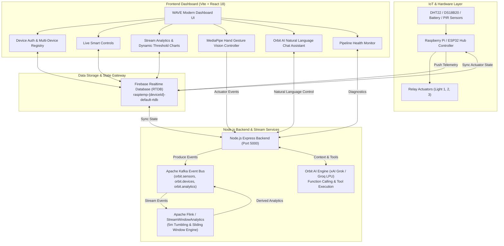
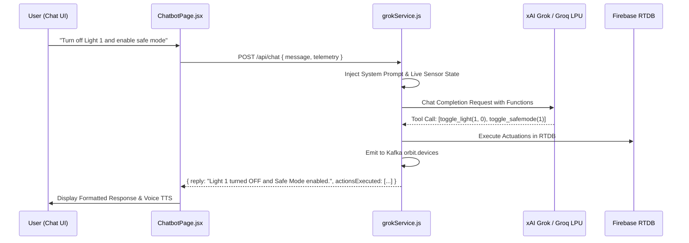

# WAVE Smart Hub & ORBIT Architecture: A-to-Z Technical Documentation

This document provides a complete technical explanation of the **WAVE Smart Home & Stream Analytics Dashboard** by Automattrix. Every page, architectural subsystem, real-time algorithm, and backend microservice is detailed below with complete code snippets and implementation logic.

---

## Table of Contents
1. [System Architecture & Technology Stack](#1-system-architecture--technology-stack)
2. [Firebase Realtime Database (RTDB) Schema & Push-ID Timestamps](#2-firebase-realtime-database-rtdb-schema--push-id-timestamps)
3. [Page-by-Page Technical Breakdown](#3-page-by-page-technical-breakdown)
   - [3.1 Page 1: Device Authentication & Multi-Device Registry (`LoginPage.jsx`)](#31-page-1-device-authentication--multi-device-registry-loginpagejsx)
   - [3.2 Page 2: Live Smart Controls & Automation (`DashboardPage.jsx`)](#32-page-2-live-smart-controls--automation-dashboardpagejsx)
   - [3.3 Page 3: Telemetry & Apache Flink Stream Analytics (`AnalyticsPage.jsx`)](#33-page-3-telemetry--apache-flink-stream-analytics-analyticspagejsx)
   - [3.4 Page 4: Computer Vision Hand Gesture Controller (`GesturePage.jsx`)](#34-page-4-computer-vision-hand-gesture-controller-gesturepagejsx)
   - [3.5 Page 5: Orbit AI Intelligent Assistant (`ChatbotPage.jsx` & `grokService.js`)](#35-page-5-orbit-ai-intelligent-assistant-chatbotpagejsx--grokservicejs)
   - [3.6 Page 6: Pipeline & Service Health Monitor (`PipelineHealthPage.jsx`)](#36-page-6-pipeline--service-health-monitor-pipelinehealthpagejsx)
4. [Backend Microservice Architecture & REST API](#4-backend-microservice-architecture--rest-api)
5. [Apache Kafka Event Streaming & Apache Flink Engine](#5-apache-kafka-event-streaming--apache-flink-engine)
6. [Security Interlocks, Thresholds & Alerting Systems](#6-security-interlocks-thresholds--alerting-systems)
7. [Installation, Environment Variables & Deployment](#7-installation-environment-variables--deployment)

---

## 1. System Architecture & Technology Stack

WAVE is an enterprise-grade IoT telemetry, stream processing, computer vision, and AI-assisted automation platform.



### Core Technologies
- **Frontend**: React 18, Vite 5, Vanilla CSS Design System, Chart.js & React-Chartjs-2, Lucide Icons, MediaPipe Hands & Camera Utils, EmailJS.
- **Backend**: Node.js (ES Modules), Express.js, Axios, Dotenv, KafkaJS, CORS.
- **Data Engine**: Firebase Realtime Database (RTDB), Apache Kafka, Apache Flink / PyFlink.
- **AI & Computer Vision**: xAI Grok / GroqCloud LPU LLM API with Function Calling, MediaPipe Hands landmark tracker.

---

## 2. Firebase Realtime Database (RTDB) Schema & Push-ID Timestamps

### 2.1 Node Hierarchy & Key Specifications
Each IoT device connects to a dynamic database instance structured as `https://rasptemp-{deviceId}-default-rtdb.firebaseio.com/`:

| Database Path | Data Type | Description | Example Values |
| :--- | :--- | :--- | :--- |
| `/temp` | Push-Key Dictionary | Historical & live Room Temperature readings in °C | `{"-P-SKfd_...": 27.16}` |
| `/humidity` | Push-Key Dictionary | Historical & live Room Humidity in % | `{"-P-SKfd_...": 54.20}` |
| `/btry` or `/distbtry` | Push-Key Dictionary | Sensor battery level in % | `{"-P-SI1b_...": 100}` |
| `/pitemp` | Push-Key Dictionary | Raspberry Pi / Hub Core Temperature in °C | `{"-P-SI1b_...": 48.7}` |
| `/dist` | Push-Key Dictionary | Motion sensor PIR / Ultrasonic distance flag | `{"-P-YORu_...": true}` |
| `/light1` | Push-Key Dictionary / Scalar | Relay Actuator 1 state (0 = OFF, 1 = ON) | `1` or `0` |
| `/light2` | Push-Key Dictionary / Scalar | Relay Actuator 2 state (0 = OFF, 1 = ON) | `1` or `0` |
| `/light3` | Push-Key Dictionary / Scalar | Relay Actuator 3 state (0 = OFF, 1 = ON) | `1` or `0` |
| `/masterSwitch` | Push-Key Dictionary / Scalar | Safe Mode Master Switch interlock (0/1) | `1` or `0` |
| `/schedule` | Object | Automated timer schedule for Light 3 | `{"light_schedule_on": "22:00", "light_schedule_off": "06:00"}` |
| `/analytics` | Object | Real-time computed 5m sliding window metrics | `{"avgTemp5m": 27.33, "minTemp": 26.31, "maxTemp": 27.16, "trend": "stable"}` |

### 2.2 48-Bit Base64 Push-ID Timestamp Decoder
Firebase Push IDs (such as `-P-SKfd_SHgszBx42wMz`) encode the creation timestamp in the first 8 characters using an ASCII/base64 character set:

```javascript
// frontend/src/services/firebase.js
const PUSH_CHARS = '-0123456789ABCDEFGHIJKLMNOPQRSTUVWXYZ_abcdefghijklmnopqrstuvwxyz';

export function decodePushIdTimestamp(id) {
  if (!id || typeof id !== 'string' || id.length < 8) return Date.now();
  let time = 0;
  for (let i = 0; i < 8; i++) {
    const c = id.charAt(i);
    const val = PUSH_CHARS.indexOf(c);
    if (val === -1) return Date.now();
    time = time * 64 + val;
  }
  // Sanity check: valid timestamp between 2020 and 2035
  if (time > 1577836800000 && time < 2051222400000) {
    return time;
  }
  return Date.now();
}
```
**Why this matters**: This enables the system to compute precise chronological sliding window statistics across historical sensor data points without requiring an explicit timestamp payload from lightweight microcontroller clients.

---

## 3. Page-by-Page Technical Breakdown

---

### 3.1 Page 1: Device Authentication & Multi-Device Registry (`LoginPage.jsx`)

#### Technical Purpose
Provides a cybernetic, glassmorphism authentication entrance that allows users to connect to any IoT device by entering its Device ID (e.g. `d5695`), quick-launching the default device, or registering new IoT devices with custom RTDB endpoints.

```
+-------------------------------------------------------------------------+
|                              WAVE SMART HUB                             |
|              [ Connect Device ]     [ Register New Device ]             |
|                                                                         |
|  Device ID / Node Key: [ d5695                 ] [ Test Ping (32ms) ]   |
|  Target RTDB: https://rasptemp-d5695-default-rtdb.firebaseio.com        |
|                                                                         |
|  [ ⚡ Quick Launch Default Device (d5695)                         -> ]  |
|  [ Enter Dashboard                                                -> ]  |
|                                                                         |
|  Registered Devices (1):                                                |
|  [ Primary Hub (d5695) • Default                               Connect ]|
+-------------------------------------------------------------------------+
```

#### Key Technical Features:
1. **Dynamic URL Resolution**:
   Given a device ID (e.g. `d5695`), the resolver formats the target Firebase endpoint:
   ```javascript
   export function resolveDatabaseUrl(deviceIdOrUrl) {
     if (!deviceIdOrUrl) return `https://rasptemp-d5695-default-rtdb.firebaseio.com`;
     const clean = deviceIdOrUrl.trim();
     if (clean.startsWith('http://') || clean.startsWith('https://')) {
       return clean.replace(/\/$/, '');
     }
     const sanitizedId = clean.replace(/[^a-zA-Z0-9_-]/g, '');
     return `https://rasptemp-${sanitizedId}-default-rtdb.firebaseio.com`;
   }
   ```

2. **Live Device Reachability Ping (`testDeviceConnection`)**:
   Pings the Firebase shallow REST endpoint with a timeout to calculate network latency and verify connection before entering:
   ```javascript
   export async function testDeviceConnection(deviceIdOrUrl) {
     const url = resolveDatabaseUrl(deviceIdOrUrl);
     const startTime = performance.now();
     try {
       const controller = new AbortController();
       const timeoutId = setTimeout(() => controller.abort(), 4500);
       const res = await fetch(`${url}/.json?shallow=true`, {
         method: 'GET',
         signal: controller.signal
       });
       clearTimeout(timeoutId);
       const latency = Math.round(performance.now() - startTime);
       return { online: res.ok, latency, url, error: null };
     } catch (err) {
       return { online: false, latency: Math.round(performance.now() - startTime), url, error: err.message };
     }
   }
   ```

3. **Dynamic Firebase App Instance Switching**:
   Initializes and binds a unique Firebase App singleton for the selected device without requiring a full browser reload:
   ```javascript
   export function switchActiveDevice(device) {
     const deviceObj = typeof device === 'string' 
       ? { deviceId: device, databaseURL: resolveDatabaseUrl(device), name: `Device ${device}` }
       : { ...device, databaseURL: device.databaseURL || resolveDatabaseUrl(device.deviceId) };

     saveStoredActiveDevice(deviceObj);
     addDeviceToRegistry(deviceObj);
     const config = createFirebaseConfig(deviceObj);
     currentDb = initAppInstance(config);
     return { device: deviceObj, db: currentDb };
   }
   ```

---

### 3.2 Page 2: Live Smart Controls & Automation (`DashboardPage.jsx`)

#### Technical Purpose
The central control panel providing real-time hardware status, neumorphic 3D interactive toggle switches for lights, security safe mode interlocks, and automated time scheduler.

```
+-------------------------------------------------------------------------+
| [ Room Telemetry ]  [ Safe Mode (Master) ]  [ Light 1 (Living Room) ]   |
| Temp: 27.16°C       Status: UNLOCKED        Switch: [ (●) ON ]          |
| Humidity: 54.2%     Action: [ ( ) LOCK ]    Status: Active              |
| Battery: 100%                                                           |
| Motion: Clear                                                           |
+-------------------------------------------------------------------------+
| [ Light 2 (Kitchen) ] [ Light 3 & Scheduler ] [ Hub Pi CPU Thermal ]    |
| Switch: [ ( ) OFF ]   Switch: [ (●) ON ]       Core Temp: 48.7°C        |
|                       Schedule: 22:00 -> 06:00 Health: Optimal (<55°C)  |
|                       [ Save Schedule ]                                 |
+-------------------------------------------------------------------------+
```

#### Component Architecture:
- **`SensorCard.jsx`**:
  Displays real-time Temperature (°C), Humidity (%), Battery level (%), and Motion status (Movement Detected / Clear) with dynamic color badges.
- **`SafeModeCard.jsx`**:
  Controls the master security interlock. When Safe Mode is `ON` (Master Switch = 1), all light toggles are programmatically disabled, preventing unauthorized manual/gesture changes, and any motion detected immediately triggers emergency alerts.
- **`LightCard.jsx`**:
  Contains a custom CSS 3D Neumorphic switch (`.wrap-check-1`) with pulsing glowing balls and instant state synchronization:
  ```javascript
  export async function toggleLight(lightNumber, state) {
    const activeDb = getDb();
    const nodeRef = push(ref(activeDb, `light${lightNumber}/`));
    const val = state ? 1 : 0;
    await set(nodeRef, val);
    return val;
  }
  ```
- **`ScheduleCard.jsx`**:
  Allows setting automated `light_schedule_on` and `light_schedule_off` times (e.g. `22:00` to `06:00`) stored under `/schedule` in Firebase.
- **`HubTempCard.jsx`**:
  Monitors the Raspberry Pi host processor temperature with automated thermal throttling warnings at $> 55^\circ\text{C}$.
- **`NotificationToast.jsx` & EmailJS Integration**:
  Dispatches instant UI toast notifications and triggers automated alert emails via EmailJS:
  ```javascript
  export function sendAlertEmail(value, msg) {
    const templateParams = {
      to_name: 'User',
      message: `${msg}: ${value}.`,
      reply_to: 'nayangc2005@gmail.com'
    };
    return emailjs.send('service_yr2ypt5', 'template_oeop7br', templateParams);
  }
  ```

---

### 3.3 Page 3: Telemetry & Apache Flink Stream Analytics (`AnalyticsPage.jsx`)

#### Technical Purpose
Executes mathematical stream processing over a 5-minute sliding window, renders dynamic threshold-colored telemetry charts (Chart.js), and detects sudden thermal and humidity spikes in real time.

```
+-------------------------------------------------------------------------+
| ⚡ APACHE FLINK 5-MIN TUMBLING & SLIDING WINDOW STREAM ENGINE            |
| Room 5m Avg: 27.33°C (🟢 Normal)   | Hub 5m Avg: 48.97°C (Optimal)       |
| Min: 26.31°C | Max: 27.16°C (26 pts)| Min: 46.1°C | Max: 48.8°C          |
| Trend: Stable (±0.04°C)             | Stream Status: 🟢 Normal           |
+-------------------------------------------------------------------------+
| [ Temperature History ]              [ Humidity History ]               |
| Dynamic: 🟢 ≤30°C | 🔴 >30°C        | Range: 🔵 30-70% | 🔴 >70%         |
| [ Chart Canvas with Segments ]       [ Chart Canvas with Segments ]     |
+-------------------------------------------------------------------------+
```

#### Key Technical Algorithms:

#### 1. 5-Minute Sliding Window Stream Processor (`streamAnalytics.js`)
Extracts timestamps from the raw time-series data, bounds the window to $T_{\text{latest}} - 300,000\text{ms} \le t \le T_{\text{latest}}$, and computes statistical metrics:
```javascript
export function compute5mWindowMetrics(rawData, fallbackVal = 28.5) {
  // 1. Decode timestamps & values
  let items = Object.keys(rawData).map(key => ({
    val: parseNumeric(rawData[key]),
    ts: decodePushIdTimestamp(key)
  })).filter(i => typeof i.val === 'number' && !isNaN(i.val));

  items.sort((a, b) => a.ts - b.ts);
  const latestItem = items[items.length - 1];
  const windowCutoff = latestItem.ts - (5 * 60 * 1000); // 5 minutes

  let windowItems = items.filter(item => item.ts >= windowCutoff);
  if (windowItems.length < 2) windowItems = items.slice(-10);

  const values = windowItems.map(i => i.val);
  const sum = values.reduce((a, b) => a + b, 0);
  const avg = +(sum / values.length).toFixed(2);
  const min = +Math.min(...values).toFixed(1);
  const max = +Math.max(...values).toFixed(1);

  // 2. Trend Slope: First half vs Second half
  let trend = 'stable';
  if (values.length >= 4) {
    const half = Math.floor(values.length / 2);
    const firstHalfAvg = values.slice(0, half).reduce((a, b) => a + b, 0) / half;
    const secondHalfAvg = values.slice(half).reduce((a, b) => a + b, 0) / (values.length - half);
    const diff = secondHalfAvg - firstHalfAvg;
    if (diff > 0.25) trend = 'rising';
    else if (diff < -0.25) trend = 'falling';
  }

  // 3. Thermal Anomaly: Current deviates by > 3.0°C from 5m mean
  const anomalyDetected = Math.abs(latestItem.val - avg) > 3.0;

  return { avgTemp5m: avg, minTemp: min, maxTemp: max, trend, anomalyDetected, sampleCount: values.length };
}
```

#### 2. Dynamic Threshold Graph Line Colors (Chart.js Segments)
Configures Chart.js segment callback functions so the line changes color dynamically depending on the data value:
- **Temperature Line**: **🟢 Green (`#10b981`)** when $\le 30^\circ\text{C}$, **🔴 Red (`#ef4444`)** when $> 30^\circ\text{C}$.
```javascript
const createTempChartData = () => {
  const values = tempHistory.values;
  const labels = tempHistory.labels;
  const pointBgColors = values.map(v => (v > 30 ? '#ef4444' : '#10b981'));

  return {
    labels,
    datasets: [{
      label: 'Room Temperature',
      data: values,
      borderColor: '#10b981',
      segment: {
        borderColor: (ctx) => {
          const val = ctx.p1?.parsed?.y ?? ctx.p0?.parsed?.y ?? 0;
          return val > 30 ? '#ef4444' : '#10b981';
        },
        backgroundColor: (ctx) => {
          const val = ctx.p1?.parsed?.y ?? ctx.p0?.parsed?.y ?? 0;
          return val > 30 ? 'rgba(239, 68, 68, 0.15)' : 'rgba(16, 185, 129, 0.15)';
        }
      },
      pointBackgroundColor: pointBgColors,
      fill: true,
      tension: 0.35
    }]
  };
};
```

#### 3. Real-Time Sudden Spike Anomaly Detector
Evaluates delta changes between consecutive readings:
- **Temperature Spike**: $|\Delta T| \ge 2.0^\circ\text{C}$
- **Humidity Spike**: $|\Delta H| \ge 6.0\%$
```javascript
export function detectSuddenSpike(sensorType, currentVal, recentHistory = []) {
  const validHistory = recentHistory.filter(v => typeof v === 'number');
  if (validHistory.length === 0) return null;
  const prevVal = validHistory[validHistory.length - 1];
  const delta = +(currentVal - prevVal).toFixed(2);

  const threshold = sensorType === 'temperature' ? 2.0 : 6.0;
  if (Math.abs(delta) >= threshold) {
    const direction = delta > 0 ? 'Surge' : 'Drop';
    const sign = delta > 0 ? '+' : '';
    return {
      sensorType,
      isSpike: true,
      delta,
      message: `⚡ Sudden ${sensorType} ${direction}: ${sign}${delta} (${prevVal} → ${currentVal})!`
    };
  }
  return null;
}
```

---

### 3.4 Page 4: Computer Vision Hand Gesture Controller (`GesturePage.jsx`)

#### Technical Purpose
Captures local webcam video and uses Google MediaPipe Hands 21-landmark skeletal tracking in real time to recognize gestures (Open Palm vs Pinch / Closed Fist) to toggle IoT lights touch-free.

```
       [4] Tip
        \
  [8]   [3] IP
   \    /
  [7] [2] MP     MediaPipe 21 Hand Landmarks
   |   |
  [6] [1] CMC
   |   |
  [5]--[0] Wrist
```

#### Key Technical Implementation (`GestureDetector.js`):
1. **Landmark Distance Calculation**:
   Calculates the normalized Euclidean distance between the Index Finger Tip (Landmark #8) and Thumb Tip (Landmark #4):
   $$\text{dist} = \sqrt{(x_8 - x_4)^2 + (y_8 - y_4)^2 + (z_8 - z_4)^2}$$
2. **Gesture Classification Rules**:
   - **PINCH / FIST (`LIGHT_OFF`)**: $\text{dist} < 0.07$ with high confidence $\to$ Triggers `toggleLight(1, false)`.
   - **OPEN PALM (`LIGHT_ON`)**: Distance between all fingertips and wrist $> 0.28 \to$ Triggers `toggleLight(1, true)`.
3. **Debounce & Event Dispatch**:
   Implements a 1.2-second cooldown to avoid oscillating relay actuations, broadcasting the recognized gesture event to the Node.js backend (`/api/telemetry/event`) and Kafka `orbit.gestures` topic.

---

### 3.5 Page 5: Orbit AI Intelligent Assistant (`ChatbotPage.jsx` & `grokService.js`)

#### Technical Purpose
An intelligent conversational copilot powered by xAI Grok / GroqCloud LPU LLM models. It features real-time telemetry context injection, markdown rendering, browser Speech Synthesis, and autonomous function calling (Tool Execution) to control smart home hardware from natural language queries.

#### Autonomous Tool Calling Execution Pipeline:


#### Key Function Calling Implementations:
The service provides direct deterministic regex parsing and LLM tool execution for:
- `toggle_light(lightNumber, state)`: Actuates Light 1, 2, or 3.
- `toggle_all_lights(state)`: Simultaneously controls all 3 lights.
- `set_safe_mode(state)`: Locks or unlocks master switch.
- `set_schedule(onTime, offTime)`: Sets timer boundaries.
- `query_sensor_status()`: Summarizes current temperatures, humidity, and safety metrics.

---

### 3.6 Page 6: Pipeline & Service Health Monitor (`PipelineHealthPage.jsx`)

#### Technical Purpose
Provides a microservices diagnostic dashboard displaying real-time operational status, round-trip ping latency, event counters, and uptime across the architectural pipeline:

```
+-------------------------------------------------------------------------+
| [ Firebase RTDB ]       [ Node.js Backend API ]   [ Apache Kafka ]      |
| Status: UP (🟢)         Status: UP (🟢)           Status: UP (🟢)       |
| Role: Source of Truth   Port: 5000                Brokers: localhost:9092|
| Latency: 32ms           Uptime: 14,200s           Topics: 4 Active      |
+-------------------------------------------------------------------------+
| [ Apache Flink Engine ] [ PyFlink Job Manager ]   [ System Uptime ]     |
| Status: UP (🟢)         Status: READY (🟢)        Overall: HEALTHY      |
| Mode: Sliding 5m        Stream: orbit.sensors     Version: 1.0.0        |
+-------------------------------------------------------------------------+
```

---

## 4. Backend Microservice Architecture & REST API

The Express backend (`backend/src/server.js`) runs on Port 5000 and serves as the bridge between IoT streams, AI models, and databases.

### REST API Endpoints Reference

#### 1. Telemetry Endpoints (`/api/telemetry`)
- **`GET /api/telemetry/current`**:
  Returns the complete normalized system snapshot containing latest sensor values, device relay states, schedule, and computed 5m analytics.
- **`POST /api/telemetry/event`**:
  Ingests an event from IoT hardware, camera gestures, or UI, updating Firebase and emitting to Kafka.
  - **Payload**: `{ "type": "gesture_detected", "payload": { "action": "LIGHT_ON", "confidence": 98 } }`
- **`POST /api/telemetry/device`**:
  Direct actuation endpoint to toggle devices (`light1`, `light2`, `light3`, `masterSwitch`).
  - **Payload**: `{ "device": "light1", "value": 1 }`

#### 2. Orbit AI Chat Endpoint (`/api/chat`)
- **`POST /api/chat`**:
  Receives user prompt, executes any requested smart home actions, queries Grok/LLM, and returns assistant text and action confirmation metadata.
  - **Payload**: `{ "message": "What is the room temperature and is light 1 on?" }`

#### 3. Stream Analytics Endpoint (`/api/analytics`)
- **`GET /api/analytics/summary`**: Returns current sliding window metrics.
- **`POST /api/analytics/process`**: Ingests derived window metrics from Apache Flink jobs.

#### 4. Health Diagnostics (`/api/health`)
- **`GET /api/health`**: Returns operational status and latency for all microservices.

---

## 5. Apache Kafka Event Streaming & Apache Flink Engine

### 5.1 Kafka Topics & Message Schema
Event streams are segmented across 4 primary Kafka topics:
1. `orbit.sensors`: Raw high-frequency telemetry events (`temperature`, `humidity`, `hubTemp`, `battery`, `motion`).
2. `orbit.devices`: Actuator toggle and safety state changes.
3. `orbit.gestures`: Vision gesture detection events with confidence scores.
4. `orbit.analytics`: Derived 5-minute tumbling/sliding window analytical outputs.

```javascript
// backend/src/config/kafka.js
export const TOPICS = {
  SENSORS: 'orbit.sensors',
  DEVICES: 'orbit.devices',
  GESTURES: 'orbit.gestures',
  ANALYTICS: 'orbit.analytics'
};
```

### 5.2 Apache Flink Stream Processing Job (`flink/jobs/temperature_stream_analytics.py`)
Implements PyFlink streaming table source and tumbling window aggregations with event-time watermarks:

```python
# flink/jobs/temperature_stream_analytics.py
source_ddl = """
    CREATE TABLE sensor_events (
        device_id STRING,
        temperature DOUBLE,
        humidity DOUBLE,
        event_time TIMESTAMP(3),
        WATERMARK FOR event_time AS event_time - INTERVAL '5' SECOND
    ) WITH (
        'connector' = 'kafka',
        'topic' = 'orbit.sensors',
        'properties.bootstrap.servers' = 'localhost:9092',
        'format' = 'json'
    )
"""
```

---

## 6. Security Interlocks, Thresholds & Alerting Systems

### 6.1 Multi-Layer Safety Matrix
| Condition / Event | Threshold | System Action | Notification Channel |
| :--- | :--- | :--- | :--- |
| **Room High Temperature** | $> 30.0^\circ\text{C}$ | Graph segment turns 🔴 Red, status badge elevated | UI Toast & EmailJS Alert |
| **Hub Core Overheating** | $> 55.0^\circ\text{C}$ | Thermal throttling warning badge, graph turns 🔴 Red | UI Toast & Email Alert |
| **Low Battery Alert** | $< 30\%$ | Battery icon turns 🔴 Red | UI Warning Toast & Email |
| **Safe Mode Motion Breach** | Safe Mode = 1 & Motion = 1 | Security breach alert triggered | High-priority Danger Alert & Email |
| **Sudden Thermal Spike** | $|\Delta T| \ge 2.0^\circ\text{C}$ in consecutive pts | Spike logged in Anomaly Feed, high-priority banner | UI Toast & Stream Flag |
| **Sudden Humidity Spike** | $|\Delta H| \ge 6.0\%$ in consecutive pts | Spike logged in Anomaly Feed | UI Toast & Stream Flag |

---

## 7. Installation, Environment Variables & Deployment

### 7.1 Environment Variables Configuration

#### Backend `.env` (`backend/.env`):
```env
PORT=5000
FIREBASE_DATABASE_URL=https://rasptemp-d5695-default-rtdb.firebaseio.com
FIREBASE_PROJECT_ID=rasptemp-d5695
KAFKA_BROKERS=localhost:9092
GROQ_API_KEY=your_groq_api_key_here
GROK_API_KEY=your_xai_grok_key_here
```

### 7.2 Running Locally

#### 1. Start the Backend API Server:
```bash
cd backend
npm install
npm start
# Runs on http://localhost:5000
```

#### 2. Start the Frontend Dashboard:
```bash
cd frontend
npm install
npm run dev
# Runs on http://localhost:3000 (or http://localhost:5173)
```

#### 3. Build for Production:
```bash
cd frontend
npm run build
# Compiles minified bundle to dist/
```

#### 4. Run Full Stack via Docker Compose (Optional):
```bash
docker-compose up -d
```

---

## 8. Summary of File Structure

```
Dashboard/
├── backend/
│   ├── src/
│   │   ├── config/          # Firebase & Kafka configs
│   │   ├── routes/          # Express API routes (telemetry, chat, health, analytics)
│   │   ├── services/        # Firebase, Kafka, Flink Bridge, Grok AI, Weather services
│   │   └── server.js        # Main Express server entry point
│   ├── package.json
│   └── .env
├── frontend/
│   ├── src/
│   │   ├── assets/          # WAVE branding & logos
│   │   ├── components/      # Header, Sidebar, SensorCard, SafeModeCard, LightCard, ScheduleCard, HubTempCard, NotificationToast
│   │   ├── gesture/         # MediaPipe VideoGestureDetector
│   │   ├── pages/           # LoginPage, DashboardPage, AnalyticsPage, GesturePage, ChatbotPage, PipelineHealthPage
│   │   ├── services/        # firebase.js (dynamic RTDB & registry), streamAnalytics.js, api.js
│   │   ├── styles/          # index.css (complete design tokens & responsive styles)
│   │   ├── App.jsx          # Main application orchestrator & live listener lifecycle
│   │   └── main.jsx
│   ├── package.json
│   └── vite.config.js
├── flink/
│   ├── jobs/                # PyFlink streaming table jobs
│   └── stream_processor.js  # Sliding window stream analytics engine
├── docker-compose.yml       # Kafka, Zookeeper, Backend, Flink containers
└── PROJECT_DOCUMENTATION_A_TO_Z.md
```

---
*Created for Automattrix WAVE & ORBIT Smart Home Platform.*
